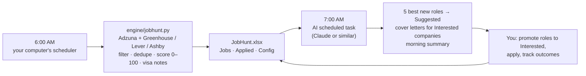

# JobHunt

**A daily job scanner that runs on your computer, plus an AI assistant that reviews the results every
morning and writes your cover letters.**

[](LICENSE)


Every morning JobHunt pulls fresh postings from job APIs and public company career boards, scores
each one against what you're looking for, flags visa sponsorship (without ever hiding a job), and
keeps the best ~50 in an Excel workbook you work from. An hour later an AI scheduled task reads the
new rows, marks the five best as **Suggested**, writes one reusable cover letter for every company you
marked **Interested**, and sends you a short summary.

The defaults are tuned for **finance, banking and analytics roles at the intern / new-grad / analyst
level**, but every title, keyword, location and weight lives in one config file, so it works for any
field.

---

## How it works



1. **Scan (local, scheduled).** `engine/jobhunt.py` collects postings, drops roles that are too senior or
   off-field, merges the same role cross-posted on several boards, scores the rest 0–100 (title match,
   keywords, seniority, location, in-person vs remote, recency), and keeps the best ~50, split across
   countries by the weights you set. New rows are **New**; untouched older rows turn **Old**; anything you
   set yourself is never overwritten.
2. **Review (AI, scheduled).** A scheduled task in an assistant that can read your files runs the prompt in
   [`prompts/daily_review.md`](prompts/daily_review.md). It only reads the workbook and writes letters;
   it never applies to anything.
3. **You decide.** Open `JobHunt.xlsx`, promote what you like to **Interested** (or **Applied**), save.
   Applied roles move to the **Applied** sheet, where you track outcomes (Interview, Offer, Rejected…).

### Cover letters: company-level and reusable

Letters are written **about the company**, not one posting, so a single letter covers every role you
flag at that firm: five Interested roles at one company get **one** letter, linked to all five. Ask for
a job-specific letter only when you want one. The assistant writes only the body, using nothing beyond
the facts you put in `profile/facts.md` and your resume; the script adds the header, date, recipient,
greeting and signature, and saves a ready-to-send PDF plus an editable DOCX:

```
Applications/<Company>/
├─ YourName.CL.pdf        ← ready to send, with your resume from master/
└─ YourName.CL.001.docx   ← editable copy (001 = running document number)
```

### Visa sponsorship notes (optional)

For international students, every row gets **Visa Sponsorship** (Yes / No / Unknown / Posting says no),
**OPT-viable**, and a note, from the posting text and a seed list of companies with public H-1B history.
It never filters: only roles requiring US citizenship or a security clearance are marked not viable. Not
relevant to you? Set `track_sponsorship: false` and those columns read N/A.

---

## Setup

```bash
git clone https://github.com/arturo-fb/jobhunt.git ~/jobhunt
cd ~/jobhunt
python3 -m pip install -r requirements.txt

cp config/config.example.yaml config/config.yaml        # your profile, target roles, locations
cp config/secrets.example.yaml config/secrets.yaml      # API keys (optional, see below)
cp profile/facts.example.md profile/facts.md            # facts cover letters may use
cp profile/writing_style.example.md profile/writing_style.md   # optional: how you write
# put your resume in master/

python3 engine/jobhunt.py --sample    # try it on bundled sample data (no internet, no keys)
python3 engine/jobhunt.py             # first live scan → creates JobHunt.xlsx
```

**On macOS, keep the project in your home folder** (e.g. `~/jobhunt`), not in `Documents`, `Desktop` or
`Downloads`. Those are privacy-protected, and a background job can't read them without Full Disk Access.

### Data sources

| Source | What it covers | Key |
|---|---|---|
| **Adzuna** | Broad market: big banks, corporates, everything on the major boards | Free at [developer.adzuna.com](https://developer.adzuna.com), instant |
| **Greenhouse / Lever / Ashby** | Public career boards of the companies in `config/companies.yaml` (fintech, asset managers, trading firms by default) | None |
| **USAJobs** | US government roles (off by default; most require citizenship) | Free at [developer.usajobs.gov](https://developer.usajobs.gov) |

Without keys the scan still runs on the public boards. No LinkedIn or Indeed scraping: that violates
their terms. Add any company that uses one of the three ATS platforms by its board token
(`boards.greenhouse.io/<token>`, `jobs.lever.co/<token>`, `jobs.ashbyhq.com/<token>`).

### Make it yours: `config/config.yaml`

- `search.titles_positive`, `keywords_target`, `titles_exclude`, `seniority_target`: what counts as a match.
- `locations`: countries in priority order, preferred cities, remote OK, and `country_weights` for how the ~50 slots are split.
- `scoring`: every weight behind the 0–100 score.
- `output.max_jobs`: how many rows to keep.
- `profile`: name and contact details for the cover-letter header.
- `standard_answers`: one place to keep your answers to screening questions.

---

## Schedule it

### 1. The daily scan on your computer

```bash
./engine/install_schedule.sh            # 6 AM local: launchd on macOS, crontab on Linux
./engine/install_schedule.sh --hour 7   # another hour
./engine/install_schedule.sh --uninstall
```

On macOS it also checks every 15 minutes and runs once as soon as the Mac wakes if it was asleep at
the scheduled time; it never scans more than once a day. **Windows:** run `engine/run_scan.sh` from WSL or
Git Bash with a daily Task Scheduler entry, or just run `python engine\jobhunt.py` on a schedule.

### 2. The morning AI review

Create a scheduled task in an assistant that can run on a schedule and read and write files on your
computer (for example Claude with scheduled tasks and folder access, or Claude Code), set it for about an
hour after the scan, and paste the prompt from [`prompts/daily_review.md`](prompts/daily_review.md).

Your part each morning: open `JobHunt.xlsx`, promote the Suggested roles you like (or your own picks) to
**Interested**, save. The next review writes the letters, or say *"make my cover letters"* to get them now.

---

## Commands

```bash
python3 engine/jobhunt.py              # live scan
python3 engine/jobhunt.py --sample     # demo run with bundled sample data
python3 engine/jobhunt.py --sync       # refresh the Applied sheet from your statuses, no scan

python3 engine/build_application.py new-today                         # today's New jobs
python3 engine/build_application.py suggest <ID> <ID> ...             # mark Suggested
python3 engine/build_application.py pending                           # companies awaiting a letter
python3 engine/build_application.py company-context "<COMPANY>"       # roles + descriptions
python3 engine/build_application.py make-company body.txt "<COMPANY>" # one reusable letter
python3 engine/build_application.py make-job <JOB_ID> body.txt        # job-specific letter
```

More in [`CHEATSHEET.md`](CHEATSHEET.md).

## Project layout

```
engine/          scanner, connectors, scoring, workbook writer, cover-letter builder, scheduler scripts
config/          config.example.yaml, companies.yaml, secrets.example.yaml
profile/         facts and writing-style templates for cover letters
prompts/         ready-to-paste prompt for the AI scheduled task
master/          your resume (git-ignored)
data/            sample jobs + visa seed list; logs and caches appear here (git-ignored)
```

Your personal files (`config.yaml`, `secrets.yaml`, `profile/*.md`, `master/`, `JobHunt.xlsx`,
`Applications/`, scan data) are all in `.gitignore`, so forking and committing never publishes them.

## Roadmap

- Fill the company ↔ visa cache automatically from public H-1B disclosure data.
- Detect interview and rejection emails and update the Applied sheet.

## License

[MIT](LICENSE) © 2026 Arturo Fraile
